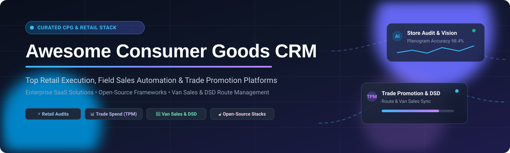

<p align="center">
  
</p>

# 🛒 Awesome-Consumer-Goods-CRM

<p align="center">
  <a href="https://github.com/ishandutta2007/Awesome-Consumer-Goods-CRM/stargazers"></a>
  <a href="https://github.com/ishandutta2007/Awesome-Consumer-Goods-CRM/network/members"></a>
  <a href="https://github.com/sindresorhus/awesome"></a>
  
  
</p>

## 🌐 Curated List of SaaS Products & Open-Source GitHub Projects
> **Essential Software Directory for Retail Execution (RetEx), Field Sales Automation (SFA), Van Sales, Direct Store Delivery (DSD), and Trade Promotion Management (TPM) in Consumer Packaged Goods (CPG) & Fast-Moving Consumer Goods (FMCG).**

---

### 📑 Table of Contents
- [📈 Sector Overview & Market Dynamics](#-sector-overview--market-dynamics)
- [☁️ SaaS / Hosted Platforms](#️-saas--hosted-platforms)
- [🔓 Open-Source GitHub Projects](#-open-source-github-projects)
- [📦 Recommended Open-Source Architecture Stack](#-recommended-open-source-architecture-stack)
- [🤝 How to Contribute](#-how-to-contribute)
- [⚠️ Disclaimer](#️-disclaimer)

---

## 📈 Sector Overview & Market Dynamics

The global **Consumer Goods CRM and Retail Execution software market** is estimated at **$10.1 Billion to $10.5 Billion** within the broader **$33.5+ Billion** CPG enterprise software landscape (with dedicated retail execution and trade spend tools driving ~$300M–$500M+ in specialized ARR). The sector is **highly fragmented** rather than winner-take-all, shaped by vast regional distribution variations (e.g., modern trade vs. fragmented traditional general trade/kirana networks), specialized niche requirements across trade promotion optimization (TPO), field image recognition/computer-vision audits, and direct store delivery (DSD) route accounting.

---

## ☁️ SaaS / Hosted Platforms

Below is the curated landscape of leading commercial SaaS platforms tailored for consumer packaged goods (CPG/FMCG) manufacturers, wholesale distributors, and field sales teams, sorted descending by company scale (valuation / annual revenue).

| 🏢 Platform | 💰 Company Scale (Revenue / Valuation) | 💵 Starting Tier Pricing | 🎁 Free Tier / Trial Limits | 🔍 Core Capabilities & CPG Focus |
| :--- | :--- | :--- | :--- | :--- |
| **[Salesforce Consumer Goods Cloud](https://www.salesforce.com/products/consumer-goods-cloud/)** | ~$41.5B Revenue (~$188.6B Market Cap) | $100 / user / month (Retail Execution Merchandiser plan, billed annually) | 30-day full-feature trial (pre-loaded with CPG store data, Einstein AI scoring & sample store visit audits; no credit card required) | Enterprise standard CRM with automated store visit planning, Einstein AI image recognition audits, van sales, and end-to-end Trade Promotion Management (TPM). |
| **[Wipro Promax (Promax TPM)](https://www.promax.com/)** | ~$11.8B Revenue (Wipro Enterprise, ~$19B Market Cap) | $1,250 / month base platform licensing (annual contract commitment) | 14-day guided proof-of-concept trial (sandbox testing for trade promotion ROI modeling; limited to invited enterprise pilot accounts) | Global enterprise Trade Promotion Management (TPM) and Trade Promotion Optimization (TPO), accrual accounting, planogram auditing, and deduction management. |
| **[Kantar XTEL](https://www.kantar.com/)** | ~$4.0B Revenue (Valued at ~$4.5B, Bain Capital) | $1,500 / month starting contract tier (structured for mid-to-large CPG brands) | 14-day sandbox pilot environment (available on demonstration request with sample retailer point-of-sale data; no public free tier) | Combines Kantar consumer panel insights with XTEL Revenue Growth Management (RGM), trade promotion planning, and commercial sales execution. |
| **[Trax Retail](https://traxretail.com/)** | ~$2.4B Valuation (~$120M Revenue, acquired by Form.com) | $250 / store / month starting retail audit tier | 14-day proof-of-concept trial (limited to 5 test store audits with computer-vision shelf recognition models) | Computer-vision and IoT-powered retail execution platform, delivering real-time shelf share, out-of-stock alerts, and planogram compliance. |
| **[AFS Technologies](https://www.afstech.com/)** | ~$28.8M Revenue (TELUS Agriculture & Consumer Goods division) | $150 / user / month starting tier (food & beverage distribution bundle) | 14-day pilot evaluation (restricted to staging environment with sample warehouse routes and DSD workflows) | Purpose-built food & beverage distribution ERP/CRM, featuring direct store delivery (DSD), van sales routing, and trade spend management. |
| **[StayinFront](https://www.stayinFront.com/)** | ~$35.2M Revenue (Estimated private) | $45 / user / month starting tier (Mobile Field Force Automation) | 14-day guided trial (includes StayinFront Touch mobile field demo with 5 mock retail accounts; requires sales activation) | Mobile field sales automation, digital merchandising, shelf compliance audits, and guided van sales routines for consumer goods reps. |
| **[Aforza](https://www.aforza.com/)** | ~$22.0M Revenue ($37.4M funding) | £20 (~$26) / user / month (Ava AI copilot tier; core TPM suites start at $120/user/month) | 14-day interactive guided demo sandbox (access to Ava AI prompts for trade promotions and field order capture) | Cloud-native suite built specifically for CPG on Salesforce/AWS, unifying trade promotion management, digital order capture, and van sales execution. |
| **[Repsly](https://www.repsly.com/)** | ~$15.1M Revenue (Acquired by Cuadrilla Capital) | $29 / user / month (Visibility / Field Team tier, billed annually) | 14-day full-feature trial (includes GPS tracking, digital form audits, and order capture for up to 5 mobile field representatives) | Field team retail execution and store management, featuring photo verification, GPS territory audits, shelf scanning, and real-time ordering. |
| **[Pitcher](https://www.pitcher.com/)** | ~$14.0M Revenue (Estimated private) | $20 / user / month starting enablement tier | 14-day managed trial (access to guided selling tablets, product catalogs, and order capture flows) | Mobile sales enablement, interactive digital detailers, order capture, and retail audit workflows connecting field sales to enterprise backends. |
| **[UpClear (BluePlanner)](https://upclear.com/)** | ~$11.5M Revenue (Private growth stage) | $800 / month starting deployment subscription tier (BluePlanner Emerging Brands edition) | 30-day proof-of-concept testing period (includes guided promotional calendar setup for up to 3 retail accounts; available upon qualification) | Revenue Growth Management (RGM) and Trade Promotion Management (TPM) platform purpose-built for emerging and growing CPG brands. |
| **[FieldAssist](https://www.fieldassist.com/)** | ~$10.0M Revenue ($25M+ valuation) | $9.90 (~₹250) / user / month (Starter field sales tier) | 14-day live sandbox trial (up to 10 field sales users, route scheduling, beat planning, and retailer ordering) | Mobile sales force automation (SFA) tailored for emerging and high-frequency retail distribution networks, van sales, and beat route optimization. |
| **[RW3 Technologies](https://www.rw3.com/)** | ~$8.5M Revenue (Integrated into Wiser Solutions) | $75 / rep / month starting field execution tier | 14-day evaluation demo (sandbox access with sample route accounting and store audit templates) | Retail audit, direct store delivery (DSD), and van route accounting software serving grocery, beverage, and consumer packaged goods distribution. |

---

## 🔓 Open-Source GitHub Projects

These open-source repositories provide self-hosted CRM, ERP, headless commerce, point-of-sale, and Product Information Management (PIM) capabilities needed to assemble transparent, vendor-independent Consumer Goods CRM stacks. Repositories are ranked descending by GitHub star count.

| 💻 Repository | ⭐ GitHub Stars | ⚖️ License | 🏷️ Category / Primary Function | 📝 CPG & Consumer Goods Capabilities |
| :--- | :--- | :--- | :--- | :--- |
| **[NocoDB](https://github.com/nocodb/nocodb)** | [](https://github.com/nocodb/nocodb/stargazers) | AGPL-3.0 | Database-CRM & Audit Builder | Open-source Airtable alternative that turns MySQL/PostgreSQL into collaborative spreadsheets for retail store audits, planogram checklists, and field task tracking. |
| **[Twenty](https://github.com/twentyhq/twenty)** | [](https://github.com/twentyhq/twenty/stargazers) | AGPL-3.0 | Modern CRM Engine | Modern open-source CRM alternative to Salesforce with clean GraphQL/REST APIs, custom object modeling for retail outlets, distributor hierarchy, and deal pipelines. |
| **[Odoo](https://github.com/odoo/odoo)** | [](https://github.com/odoo/odoo/stargazers) | LGPL-3.0 | Modular ERP / Field CRM | Comprehensive modular suite featuring Sales, POS, Inventory, and CRM. Strong community ecosystem supporting van sales routes, direct store delivery (DSD), and wholesale pricing tiers. |
| **[ERPNext](https://github.com/frappe/erpnext)** | [](https://github.com/frappe/erpnext/stargazers) | GPL-3.0 | Full CPG ERP & Distribution | Complete 100% open-source enterprise suite featuring native customer hierarchies, field sales visits, van delivery manifests, batch/expiry tracking, and multi-tier distributor pricing rules. |
| **[Chatwoot](https://github.com/chatwoot/chatwoot)** | [](https://github.com/chatwoot/chatwoot/stargazers) | AGPL-3.0 | Customer & Retailer Support | Omnichannel customer service platform to power direct WhatsApp, email, and live chat support for independent retailers, store managers, and field agents. |
| **[Medusa](https://github.com/medusajs/medusa)** | [](https://github.com/medusajs/medusa/stargazers) | MIT | Headless B2B Commerce | Modular commerce engine perfect for building custom B2B merchant ordering portals, volume discounting rules, and direct retailer reordering apps. |
| **[Activepieces](https://github.com/activepieces/activepieces)** | [](https://github.com/activepieces/activepieces/stargazers) | MIT | Workflow & Audit Automation | Open-source automation tool to synchronize field visit logs, trigger out-of-stock alerts, route promotion approvals, and connect ERP/CRM backends. |
| **[Krayin CRM](https://github.com/krayin/laravel-crm)** | [](https://github.com/krayin/laravel-crm/stargazers) | MIT | Lightweight Laravel CRM | Developer-friendly CRM with custom entity support, sales pipelines, lead routing, and lightweight REST APIs easily integrated with custom field mobile apps. |
| **[Saleor](https://github.com/saleor/saleor)** | [](https://github.com/saleor/saleor/stargazers) | BSD-3-Clause | GraphQL B2B Commerce | High-performance GraphQL commerce framework supporting multi-channel CPG catalog management, tiered wholesale price-lists, and trade promotional pricing. |
| **[Snipe-IT](https://github.com/snipe/snipe-it)** | [](https://github.com/snipe/snipe-it/stargazers) | AGPL-3.0 | Asset & Cooler Tracking | Open-source asset management for tracking field equipment deployed at retail stores (branded beverage coolers, display chillers, POS endcap hardware, and field tablets). |
| **[Invoice Ninja](https://github.com/invoiceninja/invoiceninja)** | [](https://github.com/invoiceninja/invoiceninja/stargazers) | Elastic-2.0 | Billing & DSD Invoicing | Multi-currency invoicing and payments engine suitable for field sales van delivery receipts, on-the-spot cash collections, and credit term management. |
| **[Grocy](https://github.com/grocy/grocy)** | [](https://github.com/grocy/grocy/stargazers) | MIT | Barcode & Stock Management | Barcode-based inventory and pantry tracking system adaptable for micro-warehouses, sample distribution, and retail shelf stock auditing. |
| **[Crater](https://github.com/crater-invoice-inc/crater)** | [](https://github.com/crater-invoice-inc/crater/stargazers) | GPL-3.0 | Mobile Invoicing & Receipts | Open-source billing app with companion React Native mobile app for generating instant on-site invoices, delivery receipts, and tracking customer payments. |
| **[Dolibarr](https://github.com/Dolibarr/dolibarr)** | [](https://github.com/Dolibarr/dolibarr/stargazers) | GPL-3.0 | Wholesale ERP & CRM | Mature open-source ERP/CRM with point of sale, customer relationships, warehouse management, and shipment tracking tailored for regional food & beverage distributors. |
| **[SuiteCRM](https://github.com/salesagility/SuiteCRM)** | [](https://github.com/salesagility/SuiteCRM/stargazers) | AGPL-3.0 | Enterprise Field CRM | Highly customizable open-source CRM with accounts, contacts, field sales quotes, and automated workflows extensible for store audit compliance checklists. |
| **[Open Source POS](https://github.com/opensourcepos/opensourcepos)** | [](https://github.com/opensourcepos/opensourcepos/stargazers) | MIT | Point of Sale & Retail Billing | Web-based point-of-sale system for retail outlets and franchise kiosks, handling barcode scanning, register cash tracking, and instant sales receipts. |
| **[Pimcore](https://github.com/pimcore/pimcore)** | [](https://github.com/pimcore/pimcore/stargazers) | GPL-3.0 | Product Info & Master Data (PIM) | Centralized Master Data Management (MDM) and PIM platform for managing thousands of CPG stock keeping units (SKUs), nutritional specs, packaging imagery, and barcodes. |
| **[EspoCRM](https://github.com/espocrm/espocrm)** | [](https://github.com/espocrm/espocrm/stargazers) | GPL-3.0 | Fast Single-Page App CRM | Ultra-fast responsive CRM with customizable layouts, geolocation mapping, and webhooks perfect for tracking field agent visits and retail outlet pipelines. |
| **[Akeneo PIM](https://github.com/akeneo/pim-community-dev)** | [](https://github.com/akeneo/pim-community-dev/stargazers) | OSL-3.0 | Enterprise Product Catalog | Product Information Management system to distribute accurate CPG product catalogs, trade specifications, and imagery to retail partner portals and distributors. |
| **[OpenBoxes](https://github.com/openboxes/openboxes)** | [](https://github.com/openboxes/openboxes/stargazers) | EPL-1.0 | Supply Chain & Cold Chain Stock | Inventory and supply chain management software built for medical and consumer goods distribution, stock rotation (FEFO/FIFO), and cold-chain compliance. |
| **[Vtiger CRM](https://github.com/vtiger-crm/vtigercrm)** | [](https://github.com/vtiger-crm/vtigercrm/stargazers) | MPL-2.0 | Traditional Sales Force Automation | Classic open-source CRM featuring inventory orders, customer quotes, price books, and sales pipeline management for field distributors. |

---

## 📦 Recommended Open-Source Architecture Stack

For CPG manufacturers, food & beverage brands, and regional distributors wishing to build a **100% self-hosted, vendor-independent Consumer Goods CRM stack**:

```
                       ┌──────────────────────────────────────────────┐
                       │           Field Reps & Store Audits          │
                       │    (React Native / Flutter Mobile Apps)      │
                       └──────────────────────┬───────────────────────┘
                                              │
                      ┌───────────────────────┴───────────────────────┐
                      ▼                                               ▼
         ┌────────────────────────┐                      ┌────────────────────────┐
         │     Field CRM & SFA    │                      │  B2B Reordering Portal │
         │   ERPNext / Twenty     │                      │    Medusa / Saleor     │
         └────────────┬───────────┘                      └────────────┬───────────┘
                      │                                               │
                      └───────────────────────┬───────────────────────┘
                                              │
         ┌────────────────────────────────────┼────────────────────────────────────┐
         ▼                                    ▼                                    ▼
┌───────────────────┐               ┌───────────────────┐                ┌───────────────────┐
│ Master Data (PIM) │               │ Workflow Automation│                │Asset Tracking(DSD)│
│Akeneo / Pimcore   │               │   Activepieces    │                │     Snipe-IT      │
└───────────────────┘               └───────────────────┘                └───────────────────┘
```

1. **Core CRM & ERP Engine**: **[ERPNext](https://github.com/frappe/erpnext)** or **[Twenty](https://github.com/twentyhq/twenty)** for managing accounts, store visit logs, price books, and credit limits.
2. **B2B Retailer Ordering Portal**: **[Medusa](https://github.com/medusajs/medusa)** or **[Saleor](https://github.com/saleor/saleor)** for allowing independent retail outlets to place replenishment orders 24/7.
3. **Product Information Management (PIM)**: **[Akeneo PIM](https://github.com/akeneo/pim-community-dev)** to maintain authoritative SKU catalogs, bar codes, and pack-size configurations.
4. **Field Asset & Chiller Management**: **[Snipe-IT](https://github.com/snipe/snipe-it)** to track on-premise chillers, display racks, and field sales handhelds.
5. **Real-time Event Integration**: **[Activepieces](https://github.com/activepieces/activepieces)** to route order alerts, planogram discrepancies, and SMS notifications.

---

## 🤝 How to Contribute

Contributions are warmly encouraged! To propose a new software platform or update existing metrics:

1. 🍴 **Fork** this repository.
2. ✍️ **Add or edit** entries in `README.md` keeping the Markdown tabular structure intact.
3. 🔍 **Provide specific data**: For SaaS products, verify specific starting prices, trial terms, and company revenue/valuation. For open-source repos, include accurate GitHub links and licenses.
4. 🚀 **Submit a Pull Request** with a concise explanation.

⭐ If you find this directory valuable, please consider giving it a star!

---

## ⚠️ Disclaimer

- This repository is a **community-curated index** created for educational, informational, and architectural evaluation purposes. Listed trademarks, logos, and product names belong to their respective owners.
- CPG CRM systems processing retail and personal customer data must adhere strictly to regional data protection regulations (e.g., GDPR, CCPA).
- Self-hosted open-source deployments require appropriate security hardening, robust API access control, and offline sync capability for field reps operating in low-connectivity retail environments.
